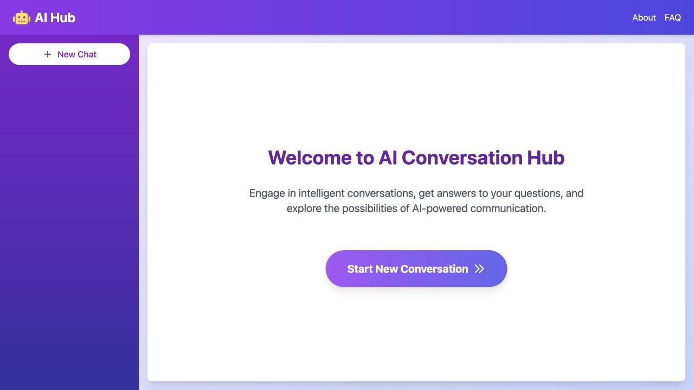

# AI Customer Support

A support-style chat app from August 2024. Replies stream in from Gemini (`gemini-1.5-pro-latest`) while they are being written, and every conversation is kept in Firestore.

[Open the live demo](https://ai-customer-support-topaz.vercel.app)



*Public demo homepage, captured November 6, 2026.*

## What happens when you send a message

1. Starting a chat creates a random ID with `uuid` and opens `/chat/<id>`.
2. `components/chat.jsx` saves your message under `chats/<id>/messages` in Firestore, then posts the whole conversation to `/api/chat`.
3. `app/api/chat/route.js` passes that history to Gemini with `generateContentStream` and streams the text back to the page.
4. When the stream finishes, the browser saves the reply next to your message. The first message of a chat becomes its title in the sidebar.

## Known limits

- The route sends no system prompt and no company information, so Gemini answers from the conversation alone.
- Your message is written to Firestore twice: once by `components/chat.jsx` and again by the API route.

## Setting it up

```bash
git clone https://github.com/gelftheshot/ai-customer-support.git
cd ai-customer-support
npm ci
```

The server route needs a Gemini key and the browser needs the Firebase web key. Put both in `.env.local`:

```dotenv
GOOGLE_GENERATIVE_AI_API_KEY=your_google_api_key
NEXT_PUBLIC_FIREBASE_API_KEY=your_firebase_web_api_key
```

The remaining Firebase settings are written into `firebase.js` for my own project. Swap them for yours, and make sure your Firestore rules let the app read and write the `chats` collection.

`npm run dev` serves the app on port 3000. For production, run `npm run build` followed by `npm start`.

If your Google key cannot use `gemini-1.5-pro-latest`, change the model name in `app/api/chat/route.js`.

Background and screenshots: [AI Customer Support write-up](https://www.lihongebre.com/projects/ai-customer-support)
